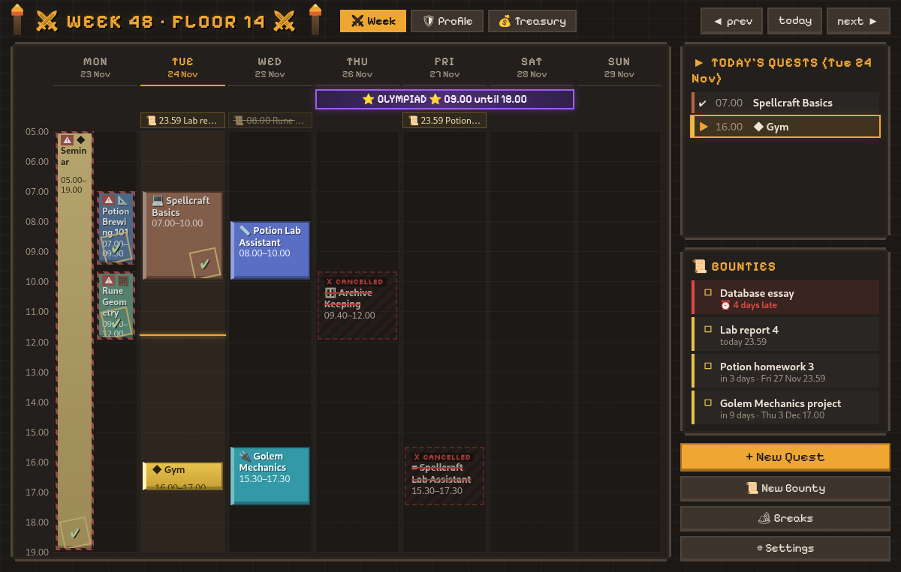
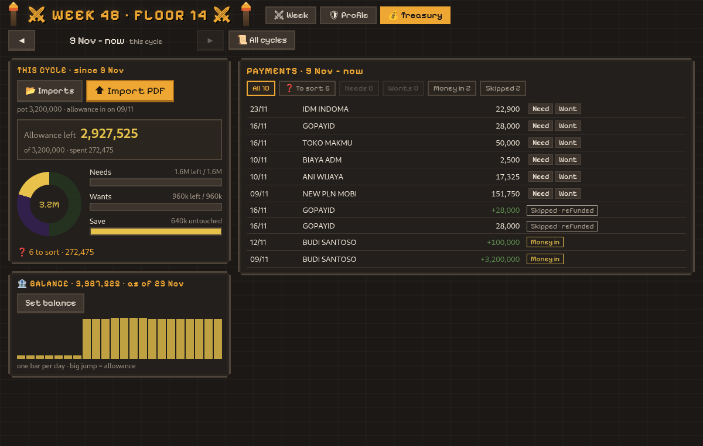

# ⚔ every tracker u need, well i think

It started life as *Dungeon Planner*, and that name stays in file and folder
names (`dungeon-planner.desktop`, `~/.config/dungeon-planner/`), so existing
installs keep their data.

A personal schedule maker for Fedora with a pixel-dungeon look. It shows
your weekly class timetable plus one-off quests and multi-day limited
events, warns about clashes, handles skips, moves and breaks, sends desktop
reminders, and can sync with Google Calendar. It also has a character
profile with habits and XP, deadlines ("bounties"), and a 50/30/20 budget
fed by bank-statement PDFs.





The example data in the screenshots and tests is made up.

## Requirements

- Fedora (tested on Fedora 45, GNOME)
- Node.js 22.13 or newer: `sudo dnf install nodejs`
- pdftotext, for importing bank statements: `sudo dnf install poppler-utils`

## Install and run

```sh
npm install        # downloads Electron (once)
npm start          # opens the app
npm test           # runs the unit tests (no Electron needed)
```

## Put it in the app grid

```sh
npm run install-desktop
```

writes `~/.local/share/applications/dungeon-planner.desktop`.

## Running in the background

Reminders only fire while the app runs, so closing the window does not quit it:

- With the **AppIndicator and KStatusNotifierItem Support** GNOME extension
  installed, the window hides to a top-bar icon (Open / Quit).
- Without it (stock GNOME), closing minimizes the window instead. Quit with
  **Ctrl+Q**.

**Start when I log in** (Settings, on by default) writes
`~/.config/autostart/dungeon-planner.desktop`, which starts the app hidden.

## Google Calendar (optional)

The app syncs two ways with Google Calendar. Your quests go into a Google
calendar called **⚔ every tracker u need, well i think**, so your phone
reminds you too, and edits you make there come back. If you tick **Two-way
with my main Google calendar** in Settings, your upcoming one-off Google
events also show up as side quests tagged 📅. Setup steps:
[docs/google-setup.md](docs/google-setup.md). While the Google app stays in
Testing mode, the sign-in ends every 7 days. The app then shows a
"Google disconnected, reconnect in Settings" notification and a Reconnect
button. The sign-in is stored encrypted (GNOME keyring) in
`~/.config/dungeon-planner/google-tokens.bin`.

## Finances (💰 Treasury)

The Treasury tab imports your BCA statements and splits each allowance
cycle's money 50/30/20 (Needs, Wants, Save). It shows spending per cycle,
your balance and the payments list, where you can fix labels. All money data
lives in the same SQLite file and is never sent anywhere (not to Google, and
it gives no XP).

Known limitations:

- Only BCA "mutasi rekening" PDFs from m-BCA are understood.
- Only IDR.
- The balance has to be set once by hand.
- A week you never imported leaves a gap in the data.
- Importing needs `pdftotext` (poppler-utils). Without it the app shows an
  install message: `sudo dnf install poppler-utils`.

## Where your data lives

Everything is in one SQLite file:

```
~/.config/dungeon-planner/dungeon.sqlite
```

Back up that file to back up all your quests. The app works fully offline.

## Learning how it was built

[docs/how-it-was-built.md](docs/how-it-was-built.md) walks through the whole build, phase by phase,
with the lessons learned and a practice path.

## How the code is organised

| Folder / file | What it does |
|---------------|--------------|
| `src/time.js` | date and time helpers (`'YYYY-MM-DD'`, `'HH:MM'`) |
| `src/schedule.js` | works out what happens on each day (the core rules) |
| `src/draft.js`, `src/layout.js` | clash warnings and side-by-side placement |
| `src/validate.js` | form checks |
| `src/db.js` | loading and saving in SQLite |
| `src/notify-plan.js` | which reminders to fire, and when |
| `src/google/` | Google sign-in (`auth.js`), the Calendar API (`api.js`), event times (`event-time.js`), what to push (`payloads.js`), pushing it (`push.js`), working out what Google's changes mean for the app (`pull.js`), one sync run that reads Google, applies the changes to the app and then pushes (`sync.js`), and when to sync (`scheduler.js`) |
| `src/bca-parse.js`, `src/merchant.js` | reads BCA statement text into payments, and tidies merchant names |
| `src/finance.js` | allowance cycles, the 50/30/20 split and balance maths |
| `src/pdf-text.js` | turns a PDF into text with `pdftotext` |
| `src/ipc.js` | the calls the window can make |
| `main.js`, `preload.js` | Electron start-up and the safe bridge to the window |
| `ui/` | the window: HTML, CSS and plain JavaScript (`ui/treasury.js` is the Treasury tab) |
| `test/` | unit tests, run with Node's built-in test runner |

Everything in `src/` except `ipc.js` is plain JavaScript with no Electron
in it, so it can be tested with plain `node`.

## SQLite library

The app uses Node's built-in `node:sqlite` module. It was checked inside
Electron 45 (which ships Node 24) and works without any extra package or
native rebuild, so `better-sqlite3` is not needed. Node prints an
`ExperimentalWarning` for `node:sqlite`; that is harmless.

## Quick self-check

```sh
DUNGEON_SMOKE=1 npm start
```

starts the app, prints what the window shows, and quits.
`DUNGEON_DEV=1` uses a separate `dev.sqlite` (fill it with
`node scripts/seed-dev.js`) and never touches the autostart entry.

## License

MIT, see [LICENSE](LICENSE). The bundled fonts keep their own SIL Open Font
License; see [ui/assets/LICENSES.md](ui/assets/LICENSES.md).
