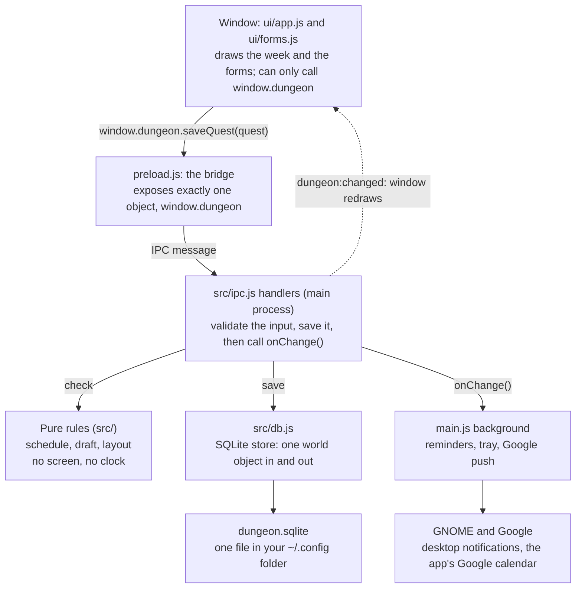

# How "every tracker u need, well i think" Was Built: A Learning Guide

21 November 2026

The app (first called *Dungeon Planner*) was built in nine phases, and three more followed: write down what it must do, plan the work, then build it from the inside out (rules first, screen last), testing every piece before moving on. The same flow works for any app you build next.

## The big picture

The app is a desktop schedule maker for Fedora: a weekly class timetable plus one-off quests and multi-day limited events, with clash warnings, skips, moves, breaks, desktop reminders and a one-way copy to Google Calendar. It is about 3,600 lines of plain JavaScript, plus about 1,500 lines of tests, in 16 commits.

The order things were built in:

1. **Spec**: a design document saying what the app does, what it doesn't, and what would count as failure.
2. **Plan**: the spec cut into 14 small tasks, each with its tests written out in advance.
3. **Pure logic**: the schedule rules as plain functions, with no screen and no database, each one test-first.
4. **Storage and planning**: the SQLite database, which reminders to fire, what Google should contain.
5. **Electron shell**: the window and the safe bridge between the window and the logic.
6. **Screen and skin**: the week grid, Today's Quests and the dungeon look.
7. **Background features**: desktop notifications, tray, start on login.
8. **Google**: sign-in and the push to the calendar.
9. **Verify, review, ship**: run everything for real, have a fresh reviewer read the whole thing, fix what it found, upload to GitHub.

The key idea: each layer only depends on the layers built before it, so every layer could be tested before the next one existed.

## Phase 1: Write the spec first

No code was written until a design document said exactly what the app should do. You can read it at [`docs/superpowers/specs/2026-11-21-schedule-maker-design.md`](superpowers/specs/2026-11-21-schedule-maker-design.md).

Why first: deciding "what happens when a seminar overlaps two classes?" costs one sentence in a document, but a rewrite once the code exists. The spec is also the judge later: when the plan and the code disagree, the spec wins.

What the spec contains, and why each part matters:

| Part | Example from this app | Why it helps |
| --- | --- | --- |
| Intent | "plans change without warning (a lecturer can't come)" | Explains the problem, so later choices have a reason |
| Goals | Skip one date, move one date, breaks | The checklist of what must exist |
| Non-goals | No two-way Google sync, Fedora only | Stops the app from growing forever |
| Anti-goals | "A cancelled quest ends up hidden" counts as failure | Things that are "working" but still wrong |
| Rules | "Touching boundaries is not a clash" (09.30 end, 09.30 start) | Exact behaviour you can turn into tests |
| Options considered | Electron vs Tauri vs Python vs C+GTK | Records why the stack was chosen |

**Try it:** before your next project, write one page with these six headings. If you can't write a rule as one exact sentence, you're not ready to code it.

## Phase 2: Cut the spec into a plan

The plan ([`docs/superpowers/plans/2026-11-21-schedule-maker.md`](superpowers/plans/2026-11-21-schedule-maker.md)) turned the spec into 14 tasks. Each was small enough to finish, test and commit in one sitting.

Every task in the plan has the same parts:

- **Files**: which files it creates or changes.
- **Interfaces**: the exact functions it produces, for example `expandDay(world, date) -> Occurrence[]`, and which earlier functions it uses.
- **Steps**: write the failing tests, run them and see them fail, write the code, run them and see them pass, commit.
- **Expected**: what each command should print, so you know at once when something is off.

The plan also has two lists that are worth copying:

- **Shared data shapes**: one place that defines what a Quest, a Change, a Break and an Occurrence look like. Every task uses the same shapes, so the pieces fit when they meet.
- **Review focus**: the five cases most likely to break, such as "a semester that starts on a Wednesday" and "an event that ends at exactly 00:00". Each one got its own test.

Before starting, the tasks were checked against each other: does what Task 3 produces match what Task 4 expects? That check is cheap and catches mismatches before any code exists.

**Try it:** for your next feature, write the function names and their inputs and outputs before writing any body. If two parts disagree on a shape, fix it on paper.

## How the code fits together

The code is in layers, and the rules sit at the bottom, where no screen, database or clock is involved. That's what made every rule testable with plain `npm test`.



Reading it as one click: the window calls `window.dungeon.saveQuest`, the preload passes it as an IPC message, the handler validates and saves through the rules and the database, then `onChange()` re-plans reminders, schedules a Google push, and tells the window to redraw.

## Phase 3: Pure logic first, test-first

The schedule rules were written as plain functions that take data in and give data back, with no screen, no database and no clock. Tests run in under a second with `npm test`, using Node's built-in test runner, so nothing extra had to be installed.

Every function followed the same loop, called test-driven development (TDD):

1. **Red**: write a test for behaviour that doesn't exist yet. Run it and watch it fail.
2. **Green**: write the simplest code that makes it pass.
3. **Refactor**: tidy up while the tests stay green.

A real test from `test/schedule.test.js`:

```js
test('exactly touching is not a clash', () => {
  const world = makeWorld();
  world.quests.push(quest({ id: 11, kind: 'side', repeat: 'once', name: 'A',
    date: '2026-11-28', start: '08:00', end: '09:30' }));
  world.quests.push(quest({ id: 12, kind: 'side', repeat: 'once', name: 'B',
    date: '2026-11-28', start: '09:30', end: '10:00' }));
  const day = expandDay(world, '2026-11-28');
  assert.deepEqual(byName(day, 'A').clashKeys, []);
});
```

Watching it fail matters: a test that passes before the code exists isn't testing anything. That really happened here. The first version of this test used a Tuesday, which already has a 07.00–10.00 class, so it failed for the wrong reason. Seeing the failure exposed the mistake in the test.

The modules, in the order they were built:

| File | What it does | Lines |
| --- | --- | --- |
| `src/time.js` | Dates as `'YYYY-MM-DD'`, times as `'HH:MM'`, weekday maths | ~140 |
| `src/validate.js` | Form checks, e.g. "end must be after start" | ~110 |
| `src/schedule.js` | `expandDay`: works out every quest on a date, in 6 steps | ~220 |
| `src/draft.js` | Clash and cancel warnings before saving | ~120 |
| `src/layout.js` | Places clashing blocks side by side | ~70 |

Two habits made this easy to test:

- **Dates as strings**: `'2026-11-23'` is easy to compare, store and print, and carries no hidden time zone. Date maths uses `Date.UTC`, so the laptop's time zone can't shift a day.
- **The clock comes from outside**: functions take `now = { date, time }` as an argument instead of calling `new Date()`. A test can then say "pretend it's Wednesday 15:24".

## Phase 4: Storage and planning, still without Electron

The next layer was the database plus two "planners": one deciding which reminders to fire, the other deciding what Google should contain. They are still plain Node code, so they were tested the same way.

- **`src/db.js` (SQLite store)**: uses Node's built-in `node:sqlite`, so there's no extra package. It loads everything into one `world` object `{ semester, quests, changes, breaks }` and saves changes back. Tests use an in-memory database (`':memory:'`), so they never touch a file.
- **Transactions**: saving a weekly quest and deleting its now-invalid skips happen together, or not at all. This is the Review Focus "edit the weekday of a quest that has skips" case.
- **`src/notify-plan.js` (reminders)**: from the world and `now`, it lists which reminders should fire and when. If you open the app late, it fires once "starts in 6 min" instead of a burst of stale reminders.
- **`src/google/payloads.js` (what Google should hold)**: each weekly class becomes one repeating event (an `RRULE` until the semester's end), and skipped or cancelled dates become exceptions (`EXDATE`).
- **`src/google/push.js` (sending only differences)**: each event body gets a fingerprint (a hash). If the fingerprint hasn't changed since the last push, nothing is sent, which is why pushing twice never makes duplicates.

The pattern to notice: the hard decisions (*what* to remind, *what* to send) live in pure functions. The parts that actually show a notification or call Google come later and stay thin.

## Phase 5: The Electron shell

Electron runs a desktop app as two kinds of process, and the bridge between them is the part to understand. In every tracker u need, well i think the window can't touch the database at all: it asks the main process, through a short list of named calls.

| Piece | File | Its job |
| --- | --- | --- |
| Main process | `main.js` | Opens the window, owns the database, reminders, tray and Google |
| Preload script | `preload.js` | Runs before the page and exposes exactly one object, `window.dungeon` |
| IPC handlers | `src/ipc.js` | One plain function per call: validate, save, then announce "data changed" |
| Renderer (the page) | `ui/` | HTML, CSS and plain JS that only draws and asks |

A save in one line of the page:

```js
const result = await window.dungeon.saveQuest(quest); // { ok: true, id } or { ok: false, errors }
```

The security settings, and why each one is on:

- **`contextIsolation: true`, `nodeIntegration: false`**: the page can't `require` anything, so a bug or a pasted script in the page can't read your files.
- **A Content-Security-Policy** in `index.html` allows only the app's own scripts.
- **`textContent`, never `innerHTML`**: quest names are inserted as text, so a quest called `<script>` is just a name.
- **A navigation guard** (added after the review): dropping a link onto the window can't take it away from the app.

The handlers were split into `buildHandlers` (plain functions, tested with `node --test`) and `registerIpc` (the one line that connects them to Electron). That split is why the bridge has tests even though Electron itself doesn't run in them.

One check paid off early: whether `node:sqlite` works inside Electron. It does (Electron 45 ships Node 24), so no native package had to be compiled.

## Phase 6: The screen and the game skin

The screen was built last on purpose: by then every rule already worked, so `ui/app.js` only had to draw what `getWeek` returned. It's plain DOM code with a small helper, `el('div', 'class', 'text')`, instead of a framework.

How the week grid is drawn:

- **Positions are percentages**: a block's `top` = (start − first hour) ÷ visible span. The grid then fits any window height without scrolling.
- **Side-by-side clashes** come from `layoutColumns`: each block gets `{ col, cols }`, which becomes `left` and `width`.
- **Every state has its own look**, set by CSS classes: `.boss` (crown and skull), `.side` (gold ◆), `.clash` (red hatched border), `.ghost.skipped`, `.ghost.moved`, `.ghost.cancelled` (struck through, ✖).
- **Limited events and breaks** are banners above the grid, using CSS grid `grid-column: 4 / 7` to span days.

The skin: two pixel fonts (Pixelify Sans, Silkscreen, both under the Open Font License) bundled in `ui/assets/fonts`, a dark stone palette as CSS variables, stepped "pixel" corners with `clip-path`, a flickering torch drawn with CSS only, and small pixel sprites written as SVG.

**Checking by eye, automatically**: a `DUNGEON_SMOKE=1` mode starts the app, runs a bit of JavaScript in the page (for example `showWeek('2026-11-30')`), saves a screenshot and quits. Looking at those screenshots caught real problems: a ⚠ tag covering the quest name, and a quiet week stretching one 1-hour block across the whole screen. The fix for the second was a minimum 8-hour time axis.

The same mode later drove the whole manual test: it filled in forms, clicked buttons and read back the dialog text.

## Phase 7: Notifications, tray and start on login

These features run in the background, so the trick was again to keep the logic testable and the Electron part thin.

- **`src/notifier.js`** takes the reminder plan and sets timers. It receives `notify` and `clock` as arguments, so the test passes a fake `notify` and uses Node's mock timers to "fast-forward" 60 seconds. It re-plans every minute, after every change and when the laptop wakes, and remembers what already fired so nothing shows twice.
- **Tray**: stock GNOME has no tray icon area. The app asks D-Bus whether the AppIndicator extension is running (`gdbus ... NameHasOwner org.kde.StatusNotifierWatcher`). With it, closing the window hides to the tray; without it, closing minimizes and Settings shows a hint.
- **Start on login**: the app writes or deletes `~/.config/autostart/dungeon-planner.desktop`, a small text file GNOME reads at login. `src/autostart.js` builds that file and is unit-tested with a temporary folder.
- **App grid**: `npm run install-desktop` writes the same kind of file into `~/.local/share/applications`.

**How it was checked for real**: `dbus-monitor` showed the actual `Notify` call to GNOME about a minute after the app started. That's a useful trick whenever you need proof that something happened outside your own code.

A bug found here: calling `window.close()` from the page destroyed the window without the normal "close" event, leaving an invisible app running. The fix: if the window is ever destroyed, quit when there's no tray. Testing the real close button showed the difference.

## Phase 8: Google sign-in and push

Google was split into four small files, each testable with fakes, so no test ever talks to the real Google.

| File | Job | Tested with |
| --- | --- | --- |
| `src/google/auth.js` | Sign-in and saving the tokens | A fake OAuth client and a fake "browser" that calls back |
| `src/google/api.js` | Wraps the Calendar API, turns errors into `{ code, authExpired }` | A fake calendar client, and the real library against a local fake token server |
| `src/google/push.js` | Compares what Google should hold with what was sent last time | An in-memory fake API |
| `src/google/scheduler.js` | When to push: 2 s after a change, retry after 5 min, and by itself 30 min after the last push | Mock timers |

How the sign-in works (the "loopback" flow for desktop apps):

1. Start a tiny web server on `127.0.0.1` at a random free port.
2. Open Google's sign-in page in your browser, with a random `state` and a PKCE code challenge.
3. You approve, and Google sends the browser back to that local server with a one-time code.
4. The app checks `state`, swaps the code (plus the PKCE secret) for tokens, and saves them encrypted with the GNOME keyring.

The scope is `calendar.app.created`: the app can only touch calendars it created itself, never your others.

Because your Google app stays in Testing mode, the sign-in expires every 7 days. `api.js` recognises Google's `invalid_grant` answer, the scheduler then stops retrying, and you get one "Google disconnected" notification plus a Reconnect button. That error shape was checked against the real Google library using a local fake server, and the test was "mutation-checked": the detection was switched off on purpose to confirm the test then fails.

Two things that make the push safe to repeat:

- Each mapping ("quest 1 = Google event abc") is saved right after its own call succeeds. If the Wi-Fi drops halfway, the next push finishes the job.
- Each push lists the events in the app's own calendar. An event you deleted in Google is recreated, and an event Google has that the app doesn't know about (a lost reply) is removed, so no duplicates.
- One week of a weekly class deleted or edited in Google is a special case. Google keeps the series and stores that week as a separate "exception" linked to it, so the push replaces the whole series with a clean copy. Weeks the app leaves out on purpose (skips, breaks) don't count. Because the app also pushes by itself every 30 minutes, this happens without clicking anything.

## Phase 9: Verify, review, fix, ship

Passing tests weren't treated as "done". The last phase checked the app the way you'd use it, then had someone with fresh eyes read all of it.

1. **Full test run**: 109 tests passing.
2. **Manual test script** ([`docs/manual-test.md`](manual-test.md)): seven steps, from first launch to the midnight error, run through the real window on a brand-new profile.
3. **Anti-goals check**: each "this would count as failure" line from the spec was checked with evidence. For example, the app was force-killed (`kill -9`) right after a save, and the quest was still there on reopen.
4. **Fresh review**: a separate reviewer read the whole branch against the spec. It found 0 critical and 4 important problems, for example the clash dialog being skipped on event days, and "ghost" blocks hidden under newer ones.
5. **Fix pass**: each fix started with a test that reproduced the problem and failed, then the fix made it pass. The suite ended at 118 tests.
6. **Ship**: merge the feature branch into `master`, rerun the tests on the merged result, and push to a private GitHub repo with `gh repo create --private --push`.

The habit behind all of it: write down every decision you make that the plan didn't, with what it costs if you were wrong. The build made 40 of these "rulings". That list is what let the reviewer question them, and is how one of them (ghosts under other blocks) was overturned.

Work on a branch, not `master`. The 15 feature commits stayed on `feat/schedule-maker` until the review was done, so `master` was never half-finished.

## After v1: fixing the leftovers

On 24 November the six small issues left from the review were fixed, the same way as the fix pass: first a test that fails, then the fix. For example, opening Settings used to add one more listener each time, and a failed Google sign-in left the browser tab spinning forever. Two of the six bugs had one cause: the edit warning and the save each had their own copy of one rule ("does this skip or move still fit the class?"), and the copies disagreed. Now there is one function, `changeFitsQuest` in `src/schedule.js`, that both use.

Using the app turned up one more bug: deleting one week of a weekly class in Google never brought it back (see Phase 8 for how it works now). The push now also runs every 30 minutes. The suite went from 118 to 127 tests.

## Phase 10: Bounties and the Profile

Two features were added the same way as v1: a short design doc, a plan, then test-first tasks.

- **📜 Bounties** are deadlines: a name, a due date and time, ticked when done. Each is pushed to Google as a 15-minute event with two reminders.
- **🛡 Profile** is a character sheet: Daily and Weekly habit quests, XP and levels, and a pixel knight whose gear changes with the level.

The one real design question was how to store XP. Working it out fresh from the data each time is less code, but deleting a class or editing a value would quietly change XP already earned. So XP is a **log**: one row per award, each with a unique key (`habit:3@2026-11-24`), so ticking twice can never pay twice and unticking removes exactly that row. When "earned stays earned" matters, store the event; don't recompute it.

This was also the first build done with **helpers**: a fresh builder wrote each task, and a separate fresh reviewer checked it before the next one began. Every task left a written report and a review, so mistakes were caught one task at a time instead of all at the end.

## Phase 11: Finances from bank PDFs

The 💰 Treasury tab reads BCA "mutasi rekening" PDFs and tracks spending against a 50/30/20 split of each monthly allowance. Its specs are [`docs/superpowers/specs/2026-11-24-finances-design.md`](superpowers/specs/2026-11-24-finances-design.md) and the plan next to it.

**Look at the real input first.** Before any design, the real statements were read locally (never copied into the repo). Five facts from them changed the design: each file covers about 8 days, there is no balance column, shop names are cut to 10 characters, two files were exact copies, and three real 28,000 charges sat on one day.

That last fact is the most useful one. Bank rows have no ID, and identical rows can be real. So "is this a duplicate?" is answered by **counting**, not by sameness: if a file has a row 3 times and the database has it 2 times, add 1.

The layers follow the same rule as v1, rules at the bottom with no files or screen:

| File | Job | Pure? |
| --- | --- | --- |
| `src/pdf-text.js` | runs `pdftotext -layout` (the only file that starts a program) | no |
| `src/bca-parse.js` | text → rows: date, amount in sen, DB/CR, text, type | yes |
| `src/merchant.js` | row → a short merchant key; card numbers removed | yes |
| `src/finance.js` | duplicates, refunds, cycles, 50/30/20 totals, balance | yes |
| `src/db.js` | three new tables (schema version 4) | no |
| `ui/treasury.js` | draws only what it is sent | no |

Two habits from this phase:

- **Money is whole numbers.** Every amount is stored in sen (`50,000.00` → `5000000`), so no decimal maths can drift. Only the window turns it back into rupiah.
- **Check against the real thing, privately.** After all tests passed, a throwaway script outside the repo imported the real PDFs into a database that lived only in memory, and printed counts only. It found a bug no made-up test had: every statement ends with lines holding only `DB` (a totals block), and they got glued onto the last payment.

The feature ended at 249 tests and was squash-merged, so the branch's 18 commits became one on `master`.

## Phase 12: Going public

Making a repo public means everything in it, including its history, can be read by anyone. A scan found the developer's name and real timetable in 7 files and in all 34 commits, and no LICENSE file.

1. **Scrub the files:** made-up example data (Potion Brewing 101, Rune Geometry…), they/them in the docs, new screenshots.
2. **Add a license:** MIT. Without one, nobody may legally use the code.
3. **Drop the history:** copy the clean files into a new folder and make one fresh commit there. That became the public repo; the private one stays as the archive. Rewriting history in place was the other option, but it can't be undone.
4. **Rename the app** to "every tracker u need, well i think". Only the visible name changed: file and folder names stay `dungeon-planner`, because Electron finds its data folder from them, so a full rename would have hidden every existing user's data.

## Lessons worth keeping

Every bug below was real, and each one teaches something you'll meet again.

| What went wrong | Why | Lesson |
| --- | --- | --- |
| `node --test test/` failed on Node 22 | Folder arguments weren't supported; a glob was needed | Run the very first command before writing anything else |
| A "touching is not a clash" test failed for the wrong reason | The chosen Tuesday already had a class at that time | Read *why* a test fails, not just *that* it fails |
| A reminder test could race | The fake timer and the fake clock moved separately | When faking time, fake the clock too (`mock.timers` with `'Date'`) |
| The window vanished but the app kept running | `window.close()` from the page skips the normal close event | Test the real user action (the ✕ button), not a shortcut |
| The sign-in test hung forever | The app waited for the browser, and the fake browser waited for the app | Two things waiting on each other = deadlock; start waiting *before* triggering |
| A fix silently didn't apply | `pkill -f "node --test"` matched and killed its own shell first | Check that an edit really landed before trusting the next test run |
| A mutation check proved nothing | `false && a \|\| b` still ran `b`: `&&` binds tighter than `\|\|` | Use brackets, and break the code in a way that really disables it |
| A deleted Google event never came back | Only changed fingerprints were sent, so "nothing changed" meant nothing was sent | Comparing with your own records can't see changes made elsewhere: look at the real thing |
| One deleted week of a weekly class never came back | The push checked that the series existed, but Google stores a changed week as a separate linked "exception" | A fake only behaves the way you assumed: learn how the real system stores things before writing the fake |
| The edit warning listed make-ups the save would delete | The same rule was written twice, in two files, slightly differently | Write a rule once and have both places call it |
| The last payment of every statement had a broken type | A totals block made of lone `DB` lines was read as part of that row | Run your parser on the real input before trusting made-up fixtures |
| Transfer rows were about to be read as QR payments | `100000.00BUDI` contains the QR marker `00000.00` too | Anchor a pattern on something only that row kind has (`QR 914`) |
| The balance chart looked flat | Bars were scaled from 0, and balances differ by little compared with their size | Scale a chart between its lowest and highest value |
| A new box put a border around a whole column | Its CSS class name was already used by the column | Search for a class name before you reuse one |
| Git history still held real data after the files were cleaned | History keeps every old version of every file | Before going public, start fresh history or rewrite it |

The pattern in most of them: the code was fine, but the test or the check was wrong. Making each check fail once on purpose is what caught them.

## Learn it yourself: a practice path

Work through these in order. Each one uses the real code in your repo and ends with something you can run. Tick them off as you go.

- [ ] **Run the tests.** `npm test`, then open `test/time.test.js` next to `src/time.js` and match each test to the function it checks.
- [ ] **Break something on purpose.** In `src/time.js`, make `weekdayOf` return the wrong day. Run `npm test`, read which tests fail and why, then undo it.
- [ ] **Your first TDD loop.** Add `formatDayLong('2026-11-23')` → `'Monday 23 November'` to `src/time.js`: test first, watch it fail, then make it pass.
- [ ] **Read the engine.** Read `expandDay` in `src/schedule.js` step by step. For Thu 26 Nov with the olympiad, write down by hand what each step changes, then check with a small test.
- [ ] **A new rule.** Write a test asking that a side quest on a break day still clashes with another side quest, and see whether the code already handles it.
- [ ] **Follow one click.** Click "Skip this date" and trace it: `ui/forms.js` → `preload.js` → `src/ipc.js` → `src/db.js` → back to the screen through `dungeon:changed`.
- [ ] **Try the smoke mode.** `node scripts/seed-dev.js`, then `DUNGEON_DEV=1 DUNGEON_SMOKE=1 DUNGEON_SHOT=week.png npm start`, and open the screenshot.
- [ ] **Change the skin.** Change one colour variable in `ui/style.css` (for example `--torch`) and look at the result.
- [ ] **Study a real fix.** Run `git show 74a88cd` (the six leftover fixes). For each one, find the test that was written first, then the lines that made it pass. Undo one fix by hand and watch its test fail.
- [ ] **Read a bank row.** Open `test/bca-fixture.js`, pick one made-up row, and trace it through `parseMutasi` in `src/bca-parse.js` and `merchantKey` in `src/merchant.js` by hand. Check your answer with a small test.
- [ ] **Count, don't compare.** Read `newRows` in `src/finance.js`, then write a test with two identical charges in the database and three in a file. How many get added?
- [ ] **A small feature, the full way.** Write a half-page spec for "export this week as text", then a plan with the function names, then build it test-first on a new branch.

Tip: when you get stuck, ask the question this guide asks at every step: can I test this piece without the screen?

## Glossary

| Term | Meaning |
| --- | --- |
| Anti-goal | Something that would count as failure even if the app "works" |
| Branch | A separate line of commits, so unfinished work doesn't touch `master` |
| CommonJS | Node's `require(...)` / `module.exports` way of splitting code into files |
| CSP | Content-Security-Policy: a rule in the page saying which scripts may run |
| Cycle | In the Treasury, the days from one allowance to the next |
| Debounce | Wait until changes stop (here 2 s) before acting once |
| Electron | Runs a web page as a desktop app, with Node.js behind it |
| EXDATE | A date left out of a repeating calendar event |
| Fake / mock | A stand-in used in tests, such as a fake Google API or fake timers |
| Hash | A short fingerprint of some data; same data, same fingerprint |
| IPC | Inter-process communication: how the window asks the main process for things |
| Loopback OAuth | Desktop sign-in where Google sends the browser back to a server on your own computer |
| Main process | Electron's Node.js side: files, database, notifications |
| Mutation check | Breaking the code on purpose to prove a test notices |
| PKCE | A one-time secret made per sign-in, so a stolen code is useless on its own |
| Preload | A script that runs before the page and decides what the page may call |
| Merchant key | A short, stable name for a shop or person, used to learn labels and spot duplicates |
| Pure function | Gives the same output for the same input and changes nothing outside itself |
| Renderer | Electron's web-page side: HTML, CSS, JS |
| Refund pair | A payment and the credit that cancels it; neither counts as spending |
| RRULE | The rule that makes a calendar event repeat, e.g. weekly until a date |
| Spec | The design document: what to build and why |
| Sen | A hundredth of a rupiah; the app stores every amount as whole sen |
| Squash merge | Merging a branch as one commit, so its in-between commits never reach `master` |
| Scope (OAuth) | What the app is allowed to touch in your Google account |
| Schema version | A number in the database saying which tables it has, so older files can be upgraded |
| TDD | Test-driven development: failing test, then code, then tidy |
| Transaction | Several database changes that all happen or none do |
